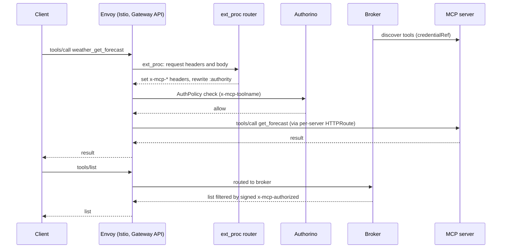
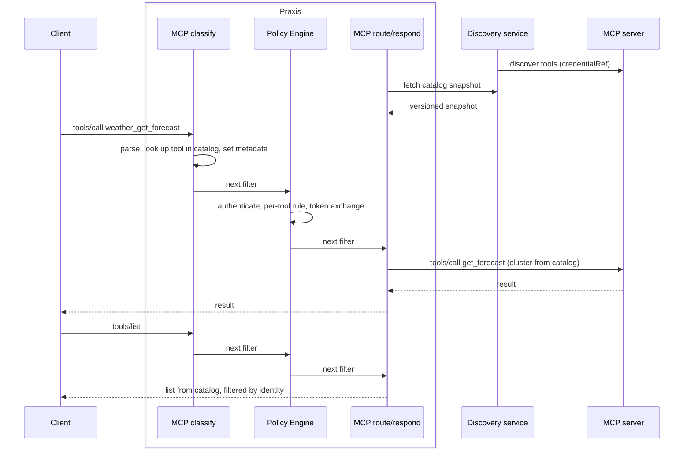

# MCP Gateway on Praxis

## Problem

MCP Gateway runs only on an Envoy-based Gateway API stack (Istio or Envoy Gateway). Envoy does not understand MCP, so the MCP logic is spread across separate pieces:

- an ext_proc router that classifies each request and sets `x-mcp-*` headers
- Authorino, which applies per-tool AuthPolicy rules
- a broker that answers list calls, manages sessions and discovers upstream tools

Several parts of the current design exist only to work around Envoy and ext_proc:

- `:authority` routing with `*.mcp.local` HTTPRoutes
- a dedicated MCP port
- the signed `x-mcp-authorized` header
- the `initialize` hairpin
- per-request body-mode switching

On top of that, users must install and run Gateway API, and an implementation of it, just to run MCP Gateway.

## Summary

Serve MCP Gateway through [Praxis](https://github.com/praxis-proxy/praxis), with no Envoy, no Istio and no Gateway API. Praxis understands MCP inside the proxy, so classification, per-tool authorization, catalog serving and routing all happen in one process. A separate discovery service talks to upstream MCP servers and keeps their credentials out of the proxy. The controller generates the Praxis deployment and config from our own CRDs, which take over what Gateway API does for us today.

MCP Gateway 2.0 ships on Praxis. 1.x is the last release line on Envoy, and no release supports both. Upgrading is a one-time cutover (see Migration from 1.x under idea 7).

This document covers:

- architecture ideas 1–6, which change how the gateway works on Praxis
- ideas 7–11, which remove the dependency on Gateway API
- how Praxis AI and MCP Gateway compare, and the feature ownership decision that follows
- the order of work for 2.0

## Goals

- MCP Gateway serves MCP traffic through Praxis, with no Envoy in the request path.
- MCP Gateway installs and runs with no Gateway API CRDs, no Istio and no Envoy Gateway.
- Upstream credentials (`credentialRef`) never reach the proxy.
- Users upgrading from 1.x have a documented, one-time migration: `MCPGatewayExtension` to `MCPGateway`, and registrations to `backendRef`. Policies migrate through the AuthPolicy translation Kuadrant and Praxis are building (idea 9).
- A clear split of features between Praxis AI, the Praxis Policy Engine and MCP Gateway.

## Non-Goals

- Changing the MCP protocol behaviour clients see.
- Porting Envoy-specific machinery as it is. Where a workaround exists only because of Envoy, it is dropped.
- Porting guardrails. It is already agreed that guardrails land in Praxis.

## Job Stories

### When installing MCP Gateway

When a platform engineer installs MCP Gateway on a cluster without Istio, they want it to work without installing Gateway API or a Gateway implementation, so that the gateway has fewer prerequisites and fewer components to operate.

### When restricting tools per user

When a platform engineer gives a group access to one tool on a server, they want calls to every other tool on that server to be denied at the gateway, so that access control doesn't depend on the upstream server.

### When registrations change

When an MCP developer registers, updates or deletes an MCP server, they want the gateway's tool list to follow within seconds and without restarts, so that clients see the current tools.

## Design

### Today and target

Today, a `tools/call` crosses Envoy, the ext_proc router and Authorino. List calls go to the broker, which also discovers upstream tools:



On Praxis, classification, policy, catalog serving and routing run inside one proxy. Discovery stays a separate service so upstream credentials never reach the proxy:



#### Request pipeline

Each request passes through one chain of three stages, in order:

1. **MCP classify:** parses the JSON-RPC body and looks up the tool or server in the catalog. It sets metadata: method, tool, server and cluster.
2. **Policy Engine:** authenticates the client and applies per-tool rules using that metadata. It does any token exchange for the target server.
3. **MCP route/respond:** answers from the catalog (lists filtered by identity, `server/discover`), or sets the cluster, strips the prefix and forwards. For 2025-11-25 it also sends the backend `initialize` with the credentials the Policy Engine set.

Classification must come before the Policy Engine because per-tool rules and per-server token exchange need the tool and server. Responding must come after it because list filtering needs the identity.

### Architecture ideas 1–6

These ideas change parts of the design that exist because ext_proc can route a request but cannot answer it. On Praxis, filters can answer requests directly.

#### 1. Split the broker into a discovery service, and answer 2026 list calls in Praxis

**Today:** the broker does two jobs:

- **It talks to upstream servers.** It connects using `credentialRef`, lists tools, prompts and resources, and watches `list_changed`.
- **It is the MCP server clients talk to.** It handles `initialize`, `tools/list`, `server/discover`, sessions, SSE and `/tokens`. This second job is a separate service only because ext_proc can't answer requests.

**On Praxis:** a Go discovery service keeps the upstream job and is the only place `credentialRef` lives. A Praxis filter holds the catalog in memory and answers 2026-07-28 `server/discover`, `tools/list`, `prompts/list` and `resources/list` itself. The 2025 client role stays in the broker until phase 2 replaces it.

**Why:** it removes a network hop, keeps upstream credentials out of the proxy, and makes idea 2 possible.

#### 2. Filter lists in-process instead of with a signed header

**Today:** Authorino signs `x-mcp-authorized` with ES256 so the broker, a separate process, can trust who the user is when it filters `tools/list`.

**On Praxis:** the MCP route/respond stage runs after the Policy Engine in the same process (see Request pipeline). It filters the list using the Policy Engine's identity and decision directly, with nothing to sign or carry. Signing stays only where data crosses a process boundary.

**Why:** simpler and faster, and it removes a key to manage.

#### 3. Deliver the catalog as versioned snapshots

**Today:** the controller writes a config Secret, and the broker reads it and builds the routing table in the same process. That is why the router and broker ship as one binary.

**On Praxis:** static data (clusters, prefixes, TLS, policy) goes in controller-written config. Discovered data changes at runtime and should not force a pipeline reload. The MCP filter pulls a versioned snapshot from the discovery service and swaps it in atomically. When a refresh fails, it serves the last good snapshot. When it has never loaded one, it fails closed.

- **Convergence:** each replica pulls on its own schedule, so replicas reach the same snapshot version within one refresh interval. Until then, a tool can show up in a list from one replica and be unknown on another. Each replica reports its snapshot version as a metric, so a replica stuck on an old version is visible.
- **Access:** the snapshot holds the full catalog for every registration, so Praxis and discovery use mTLS. The controller issues certificates per `MCPGateway` and rotates them, and discovery only serves the Praxis instance of its own gateway.
- **Readiness:** a replica is not ready until its first snapshot loads, so Kubernetes doesn't send traffic to a pod that rejects everything. After that, a failed refresh doesn't affect readiness. Otherwise a discovery outage would take every replica out at once.

**Why:** discovery and the proxy can restart independently without dropping traffic, and every replica serves the same catalog within one refresh interval.

#### 4. Drop the Envoy routing workarounds

**Today:**

- `:authority` is the routing signal, with per-server HTTPRoutes on made-up `*.mcp.local` hostnames.
- MCP gets its own port so ext_proc doesn't see other traffic.
- The router relies on `ClearRouteCache` and buffered-body tricks.

**On Praxis:** the MCP filter sets the upstream cluster directly from the catalog, and each registration maps to a cluster that points at its Service.

**Why:** routing becomes a lookup, not a header rewrite. This is also the first step towards ideas 7–11.

#### 5. Use separate filter chains per protocol version

**Today:** one ext_proc adapter picks `Router202511` or `Router202607` for each request, and Envoy's body mode is switched per request.

**On Praxis:** each version gets its own filter chain, chosen by a condition on `MCP-Protocol-Version`. A request without the header goes to the 2025-11-25 chain: 2026-07-28 clients must send it on every request, while 2025 clients omit it on `initialize` and may omit it after. The 2026-07-28 chain ships first and the 2025-11-25 chain follows in phase 2.

**Why:** the two versions stay fully apart. Removing 2025 later means deleting one chain.

#### 6. Replace the hairpin with an in-process sub-request

**Today:** the 2025 lazy `initialize` goes back out through Envoy so policy applies to it. The router-key JWT, `mcp-init-host` and the hairpin CA bundle exist only to support that path.

**On Praxis:** classification has already identified the target server, so the Policy Engine has authenticated the request and done any token exchange for that server. The MCP route/respond stage sends the backend `initialize` directly with the credentials the Policy Engine set.

**Why:** `router-key` (the `backend-init` JWT), `mcp-init-host`, the second policy pass and the hairpin use of `caCertBundleRef` all go away.

#### TLS trust

Today the controller does not configure upstream TLS for `tools/call`. Envoy forwards tool calls, and users set up upstream TLS in Istio or Gateway API. The CA refs only affect the broker. On Praxis, the controller writes them into each server's Praxis cluster TLS. This is a new responsibility: without it, tool calls to HTTPS upstreams fail.

| Trust material | Today | On Praxis |
| --- | --- | --- |
| System roots | Broker to upstream, 2025 hairpin | Discovery to upstream, Praxis to upstream |
| `caCertBundleRef` | Broker to upstream, 2025 hairpin to the gateway listener | Discovery to upstream, Praxis cluster TLS. No hairpin use (idea 6) |
| `caCertSecretRef` | Broker to upstream only | Discovery to upstream, and that server's Praxis cluster TLS |

### Moving away from Gateway API: ideas 7–11

Once Praxis routes by catalog lookup (idea 4), Gateway API no longer carries MCP traffic. It still does four jobs for us: it hosts the listener, identifies each server's backend, gives Kuadrant policies a target, and isolates teams. Ideas 7–11 move each job into our own CRDs, so neither MCP Gateway nor its users need Gateway API, Istio or Envoy Gateway.

#### 7. A new MCPGateway resource replaces MCPGatewayExtension

**Today:** `MCPGatewayExtension` defines an MCP gateway instance, but it does so by extending someone else's Gateway:

- `spec.targetRef` points at a Gateway listener (`sectionName`).
- The controller installs an EnvoyFilter there to wire in ext_proc, and manages the gateway's HTTPRoute.
- A cross-namespace ReferenceGrant is needed.

Most of its other fields configure the instance itself (hostnames, OAuth metadata, sessions, elicitation) and have nothing to do with Envoy.

**Proposed:** a new kind, `MCPGateway`, is the gateway itself. It describes its own Praxis deployment and listener. The controller creates:

- the Praxis Deployment
- the discovery service
- their Services
- the generated Praxis config: listener, TLS and filter chains

Traffic from outside the cluster arrives through ordinary Kubernetes means.

```yaml
kind: MCPGateway
spec:
  publicHost: mcp.example.com
  listener:
    port: 8443
    tls:
      secretRef: mcp-tls        # e.g. from a cert-manager Certificate
  expose:
    type: LoadBalancer          # or ClusterIP + OpenShift Route / existing ingress
  oauthProtectedResource: {...}
```

**Why a new kind instead of changing the existing one:** "extension" only makes sense while the resource extends a Gateway, and a new kind means no release where one kind means two different things.

**Migration from 1.x:** 2.0 removes `MCPGatewayExtension`, so upgrading is a one-time cutover with no period where both run:

1. Convert each `MCPServerRegistration` from `targetRef` to `backendRef`.
2. Create an `MCPGateway` with the settings from the old `MCPGatewayExtension`.
3. Delete the `MCPGatewayExtension`, and the Gateway, HTTPRoutes and ReferenceGrants it used if nothing else needs them.
4. Point clients at the new host. 2025-11-25 clients start a new session.

#### 8. MCPServerRegistration points at a Service

**Today:** `spec.targetRef` must be an HTTPRoute with exactly one backendRef. The controller reads the backend Service from it.

**Proposed:** the registration names the Service directly. The controller turns each registration into a Praxis cluster, and discovery maps each tool to that cluster in the catalog snapshot.

The Service must be in the registration's own namespace. Today a registration can target an HTTPRoute in another namespace, and that route's backend can be in a third. The controller reads that Service without checking a ReferenceGrant, so the broker can reach it. Only Envoy's `tools/call` routing enforces ReferenceGrant. On Praxis, the proxy forwards tool calls itself, so allowing cross-namespace references would let anyone who can create a registration send gateway traffic to any Service in the cluster.

```yaml
kind: MCPServerRegistration
spec:
  backendRef:
    name: weather-server        # Service in the registration's namespace
    port: 8080
  path: /mcp
  toolPrefix: weather_
  credentialRef: {...}
```

On `tools/call`, the MCP filter looks up the tool, sets the cluster, strips the prefix, and Praxis forwards the call.

#### 9. Policies attach to MCP resources

**Today:** AuthPolicy and RateLimitPolicy target a Gateway listener, which is the usual case in our samples, or an HTTPRoute.

**What Kuadrant and Praxis plan today:** policy on Praxis is already being worked on, but every plan routes it through Gateway API:

- [kuadrant-operator#2336](https://github.com/Kuadrant/kuadrant-operator/issues/2336) is the epic for supporting Praxis as a target Gateway. Its "How" is still to be decided.
- [kuadrant-operator#2337](https://github.com/Kuadrant/kuadrant-operator/issues/2337) is the steel-thread spike, which is the most concrete version of the plan:
    1. The Kuadrant operator reconciles AuthPolicy into a new **PolicyFilter** resource.
    2. The Praxis operator, running with Gateway API, turns that PolicyFilter into Praxis config.
    3. An AuthPolicy-to-PPE transpiler does the conversion. It is planned both in-process and as a CLI.
- [policy#100](https://github.com/praxis-proxy/policy/issues/100) is the PPE epic:
    - AuthPolicy moves to a **v2 API** that supports a subset of v1 ([policy#195](https://github.com/praxis-proxy/policy/issues/195): JWT and API key are done).
    - Limitador becomes a PPE plugin ([policy#143](https://github.com/praxis-proxy/policy/issues/143)), so rate limiting runs after authentication.
- [policy#104](https://github.com/praxis-proxy/policy/issues/104) covers policy attachment. Its targets are Gateway API and Gateway API Inference Extension resources (InferenceModel, InferencePool).

None of these issues mention MCP resources, so attaching policies to them would be a new request to Kuadrant.

**Proposed:** Kuadrant policies use `targetRef` to point at `MCPGateway` (the whole gateway) or `MCPServerRegistration` (one server). Users keep the policy API they know. There are two ways to deliver this, both building on the PolicyFilter and transpiler work above:

1. **Kuadrant resolves our CRDs as policy targets.** The Kuadrant operator learns about `MCPGateway` and `MCPServerRegistration`, then produces PolicyFilters for the Praxis deployment the MCP Gateway controller created. This is the cleanest for users, but needs the most Kuadrant work.
2. **The MCP Gateway controller produces the PolicyFilters.** Kuadrant policies still target our CRDs. Our controller finds the policies attached to its resources and runs the shared transpiler to generate Policy Engine config directly. Kuadrant only needs to accept our kinds in `targetRef` and report status. Our controller takes on more work.

**Fallback:** MCP-native auth fields in our CRDs, such as allowed tools by role, compiled straight to Policy Engine rules. This needs nothing from Kuadrant, but it is a new API and leaves Kuadrant policies out.

**Whichever option we pick:** MCP rules today depend on `x-mcp-*` headers (`x-mcp-toolname`). On Praxis, the same facts are filter metadata. The Policy Engine already defines MCP attributes (`mcp.tool.name`, `mcp.tool.server_id`, `mcp.tool.annotations.*`, and the same for resources and prompts). Two things need confirming: that the praxis-ai `mcp` filter fills them in, and that the AuthPolicy v2 transpiler maps `x-mcp-toolname` rules onto them ([policy#130](https://github.com/praxis-proxy/policy/issues/130)).

**Migrating existing policies:** we don't build our own conversion. Existing AuthPolicies move to Praxis through the AuthPolicy-to-PPE translation above, and they gain coverage as AuthPolicy v2 grows past its current subset ([policy#195](https://github.com/praxis-proxy/policy/issues/195)). The MCP-specific part we need from it is the attribute mapping above. Relevant work:

- [policy#272](https://github.com/praxis-proxy/policy/issues/272): demo of migrating a supported AuthPolicy.
- [policy#109](https://github.com/praxis-proxy/policy/issues/109): examples of AuthPolicy capability mappings.
- [policy#130](https://github.com/praxis-proxy/policy/issues/130): attribute dictionary compatibility. The `request.*`, `source.*`, `destination.*` and `auth.identity` mappings are done.

#### 10. Gateway-owned endpoints live in Praxis config

**Today:** the controller creates HTTPRoutes for the gateway itself, plus a separate `/tokens` HTTPRoute when URL elicitation is on. Virtual servers are chosen with an `x-mcp-virtualserver` header.

**Proposed:** the controller generates these as routes in the Praxis config:

- `/mcp`
- `/.well-known/oauth-protected-resource`, served as a static response
- `/tokens`
- path-based virtual servers at `/vmcp/<name>`

#### 11. Isolation by deployment, admission by selector

**Today:** team isolation relies on Gateway listener ports, ReferenceGrants, and conflict checks between extensions that share a Gateway.

**Proposed:**

- **Isolation:** each `MCPGateway` gets its own Praxis pods, so teams are isolated at the pod level.
- **Admission:** a namespace or label selector on the `MCPGateway` decides which registrations it accepts. Because `backendRef` is same-namespace only (idea 8), the selector also decides which namespaces' Services the gateway can reach.
- **What goes away:** ReferenceGrants, and the listener and namespace conflict logic in the extension controller. The cost is more pods for many small teams, and a central team can no longer register servers in other namespaces from one place.

#### What each resource uses instead

| Resource | Relies on Gateway API today for | Uses instead |
| --- | --- | --- |
| `MCPGatewayExtension` | Gateway listener target, managed gateway HTTPRoute, `/tokens` HTTPRoute, ReferenceGrant | Replaced by `MCPGateway`: its own Praxis deployment and listener (7), routes in Praxis config (10), registration selector (11) |
| `MCPServerRegistration` | HTTPRoute target with one backendRef, ReferenceGrant for cross-namespace | `backendRef` to a Service in the same namespace (8) |
| `MCPVirtualServer` | Traffic through the gateway HTTPRoute, selected by header | `/vmcp/<name>` path on the Praxis listener (10) |
| AuthPolicy, RateLimitPolicy | `targetRef` to a Gateway or HTTPRoute | `targetRef` to `MCPGateway` or `MCPServerRegistration` (9) |
| Gateway, GatewayClass, HTTPRoute, ReferenceGrant | The resources themselves | Not needed |
| Istio or Envoy Gateway | Implementing the Gateway | Not needed |

A cluster that standardizes on Gateway API can still put its own Gateway in front of the Praxis Service with one HTTPRoute, like any other app. The design doesn't depend on it.

### Considerations: Praxis AI and MCP Gateway

Praxis AI is mainly an LLM inference gateway. Its MCP support covers the data-plane basics. The Kubernetes control plane, live federation, sessions and identity-aware tool access exist only in MCP Gateway. Moving onto Praxis means the two overlap, so **we need a decision on which component provides each feature** before phase 2 starts. Features only Praxis AI has (LLM inference routing, provider translation, Responses and Conversations, token metering, cross-cluster routing) are out of scope here.

### Component Responsibilities (proposed)

This is a starting point for the feature ownership decision. "To decide" marks the rows we most need input on. "In Praxis today" says whether the feature already exists in Praxis, praxis-ai or the Policy Engine (Exists), exists in part (Partial), or has to be built (New).

| Feature | Proposed owner | In Praxis today | Notes |
| --- | --- | --- | --- |
| Parse and classify MCP requests | Praxis AI | Exists | praxis-ai `mcp` filter |
| Kubernetes resources and controller | MCP Gateway | n/a | Also generates the Praxis config and deployment (ideas 7, 10) |
| Live upstream discovery and its credentials | MCP Gateway | New | Discovery service. The only holder of `credentialRef` (idea 1) |
| Catalog serving, aggregated lists, stateless routing | Praxis AI | Partial | The `mcp` filter aggregates a static, tools-only catalog from config and routes 2026-07-28 `tools/call`. Needs loading from discovery snapshots (ideas 1, 3) |
| Prompts and resources in the catalog | Praxis AI | New | Our broker serves them today. The praxis-ai catalog covers tools only |
| Resource URI rewriting | Praxis AI | New | Our router rewrites resource URIs per server today |
| Protocol version selection | Praxis core | Exists | Chain conditions on `MCP-Protocol-Version`, plus the `mcp` filter's `protocol_profile` (idea 5) |
| 2025-11-25 sessions, elicitation, SSE | To decide | Partial | praxis-ai `initialize` issues unsigned random session IDs, and `tools/call` returns `-32601` in the session profile. Port our broker logic into a filter, or extend praxis-ai's session work (ai#156, ai#179) |
| Server-to-client notifications, request ID mapping | Same owner as 2025 sessions | New | Forwarding upstream notifications and server-initiated requests to the client's session |
| Per-tool authorization | Policy Engine | Exists | CEL, OPA or Cedar rules over the PPE `mcp.tool.*` attributes. Compiled from Kuadrant policies (idea 9) |
| Per-user list filtering | Praxis AI | New | In-process, using Policy Engine identity (idea 2) |
| Tool revocation | Policy Engine | Exists | Driven by identity provider roles |
| Virtual servers, progressive discovery, user-specific lists | To decide | New | MCP Gateway defines them. Enforcement could live in Praxis AI |
| Per-user upstream credentials (Vault, token exchange) | Policy Engine | Exists | PPE `delegator/vault` and `delegator/oauth` (RFC 8693) |
| URL elicitation (`/tokens` page) | To decide | New | Ours today, with tokens encrypted in the session store. The PPE CIBA elicitation is a different flow |
| Upstream TLS per server | MCP Gateway | Exists | Praxis cluster TLS, generated by our controller from the CA refs (see TLS trust) |
| OAuth protected-resource metadata | Praxis core | Exists | `static_response`, generated by our controller (idea 10) |
| A2A | Praxis AI | Exists | praxis-ai `a2a` filter, with task routing |
| Internal header hygiene | Praxis AI | Exists | Praxis core reserved headers plus `identity_header_guard` |
| Request rate limiting | Policy Engine | Partial | Praxis core `rate_limit` is a local token bucket. The PPE `quota` plugin uses Limitador but is experimental and counts LLM tokens. Needs shared request counters (policy#143) |
| Guardrails | Praxis AI | Exists | Already agreed |
| Tracing, metrics, audit | Both | Exists | Praxis `trace_context`, `access_log`, `cloud_events` and PPE audit events. MCP audit events from MCP Gateway |
| Supported product and packaging | MCP Gateway | n/a | Praxis is alpha, with no API stability before v1.0.0 |

## Security Considerations

- **Upstream credentials stay out of the proxy.** `credentialRef` is read only by the discovery service (idea 1). Praxis never holds service credentials for listing.
- **The catalog fails closed.** With no snapshot loaded, tool calls and lists are rejected and the replica reports not ready. When a refresh fails, the last good snapshot keeps serving (idea 3).
- **The catalog is only served to its own gateway.** Praxis and discovery authenticate each other with mTLS, so other pods can't read the full catalog and bypass per-user list filtering, and one `MCPGateway` can't read another's (idea 3).
- **Default deny per tool.** When a per-tool policy applies, the Policy Engine denies any tool it doesn't explicitly allow. With no policy attached, behaviour matches today and all tools are allowed.
- **No signed identity header in-process.** Identity is passed between filters as typed metadata (idea 2), so the ES256 key pair for `x-mcp-authorized` (`TRUSTED_HEADER_PUBLIC_KEY`) is removed. Client-sent internal headers are stripped by Praxis core and `identity_header_guard`.
- **The signing key has a narrower job.** `GATEWAY_SIGNING_KEY` no longer signs `backend-init` tokens (idea 6). It still signs 2025-11-25 session IDs and derives the key that encrypts per-user upstream tokens in the session store. Only the component that owns sessions and per-user credentials holds it (phase 2).
- **Session isolation carries over (phase 2).** Whichever component owns 2025-11-25 sessions must keep today's guarantees:
    - The gateway session ID is a signed JWT, validated before routing.
    - Backend sessions are stored by gateway session ID and server, so one client can't use another's.
    - Every response, including errors, rewrites `mcp-session-id` back to the gateway session ID, so backend session IDs never reach clients.
- **No cross-namespace backends.** A registration can only reference a Service in its own namespace, so creating a registration never grants reach into another namespace (idea 8).
- **Smaller attack surface for 2025.** Removing the hairpin removes `router-key`, `mcp-init-host` and the second policy pass (idea 6).

## Phased Approach

The phases are the order of work, delivered as separate PRs. They all ship together in 2.0, and no release goes out between them. Each phase leaves a working gateway in the development branch, so the next one builds and tests on top of it. Phases 2 and 3 touch different parts of the system and can overlap once the feature ownership decision is made.

### Phase 1: stateless (2026-07-28)

**Scope:**

- Ideas 1, 2, 3 and 4, and the 2026-07-28 chain from idea 5.
- Per-tool authorization in the Praxis Policy Engine, validating identity-provider JWTs.
- Per-user list filtering in-process (idea 2), so lists never show tools the user can't call.
- OAuth protected-resource metadata on 401s.

Praxis config can be hand-written or partly generated. Registrations still use today's CRDs. Until phase 2 lands, Praxis serves 2026-07-28 clients only, and rejects requests without `MCP-Protocol-Version` with an error that names the supported version.

**Praxis changes needed:** the MCP broker loads its catalog from a remote snapshot instead of static config. The policy filter's 401 points to the resource metadata. The MCP filter can read the Policy Engine's identity and decision to filter lists. MCP logic runs both before and after the Policy Engine in one chain, either as one filter with two hooks or as two filters (`mcp-classify`, `mcp-respond`), whichever Praxis supports. Discovery maps registration names to valid Praxis cluster names.

**Done when:**

- A user allowed only one tool can call that tool through Praxis, is denied the others, and sees only that tool in `tools/list`.
- The catalog follows registration changes without restarts.
- Restarting discovery doesn't drop traffic.

### Phase 2: stateful (2025-11-25)

**Scope:**

- The 2025-11-25 chain (idea 5).
- Sessions with a shared store, lazy `initialize` through an in-process sub-request (idea 6), elicitation and SSE.

**Needs first:** the decision on who owns sessions, MCP Gateway or Praxis AI.

**Done when:**

- 2025 and 2026 clients both work on one endpoint through Praxis, with no hairpin.
- A client cannot use another client's session, and no response carries a backend session ID.

### Phase 3: control plane without Gateway API

**Scope:**

- Ideas 7–11: the controller generates the Praxis deployment and config from the new `MCPGateway` resource.
- Registrations use `backendRef`.
- Gateway-owned endpoints live in Praxis config.
- Kuadrant policies attach to MCP resources.

**Needs first:** agreement with the Kuadrant team on policy targets (idea 9).

**Done when:** MCP Gateway installs and works with no Gateway API CRDs, no Istio and no Envoy Gateway.

### Phase 4: parity and removing Envoy

**Scope:**

- The remaining features, wherever ownership put them: rate limiting with shared counters, virtual servers and curation, per-user upstream credentials, guardrails on MCP traffic, and audit.
- Hardening.
- Upstreaming the Praxis changes.
- The 1.x to 2.0 migration guide and release notes.

**Done when:** every MCP Gateway feature works on Praxis, the migration guide is published, and the following are removed:

- the Envoy router
- the ext_proc adapter
- `MCPGatewayExtension`
- the HTTPRoute `targetRef` on registrations
- the Envoy install docs

2.0 is released only once phase 4 is done.

## Future Considerations

- **Cross-namespace backends.** If users need a central team to register servers in other namespaces, add an MCP-owned grant (for example `MCPBackendGrant`), created in the target namespace, with the same meaning as ReferenceGrant. This is deferred until there is demand.

## Execution

Implementation plan, e2e test cases and documentation plan to follow in `tasks/` once the approach is agreed.
